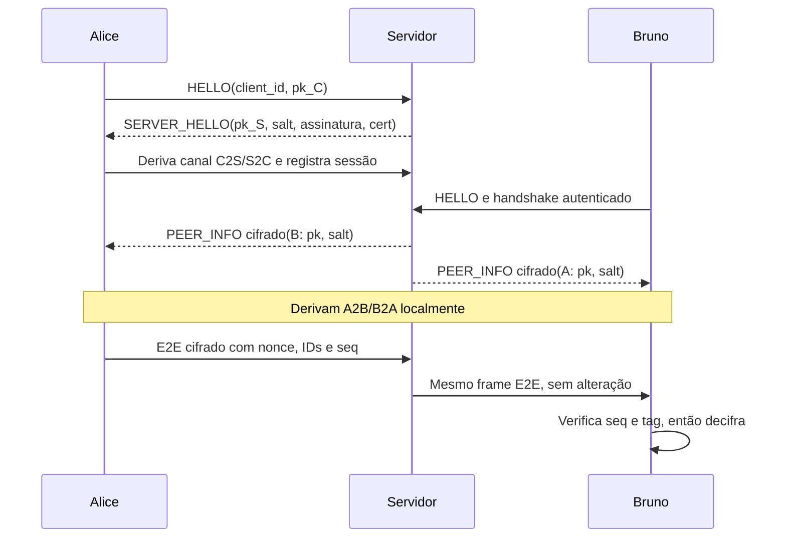

# TP3 — Mensageria segura E2E

Mensageria multi-cliente em Python 3, `asyncio` e `cryptography`. O servidor
autentica sua identidade no handshake e atua como relay; Alice e Bruno derivam
localmente chaves direcionais e o destinatário valida a tag antes de decifrar.

## Guias e material da apresentação

- [BLOCOS.md](BLOCOS.md): quatro blocos coesos, divisão sugerida para a dupla,
  conceitos criptográficos e arquivos/métodos para apresentar.
- [COMO-USAR.md](COMO-USAR.md): instalação, servidor e clientes em terminais
  separados, ataques, laboratório web e testes.
- [MERMAID.md](MERMAID.md): diagramas de sequência, um por bloco.
- [trabalho-pratico-3.md](trabalho-pratico-3.md): enunciado e critérios da
  atividade.
- [AGENTS.md](AGENTS.md): plano incremental, decisões de protocolo e status
  das etapas.

Para os comandos completos, siga [COMO-USAR.md](COMO-USAR.md). Em resumo:
instale as dependências, prepare certificado e chave local se necessário,
inicie o servidor em um terminal e execute cada cliente em outro terminal.

## Resumo do protocolo

O cliente autentica o servidor pelo certificado pinado e RSA-PSS. ECDH X25519 e
HKDF-SHA256 derivam as chaves do canal administrativo. No rendezvous, os peers
recebem as chaves públicas um do outro e derivam localmente `A2B`/`B2A`; o
servidor não recebe as chaves E2E. AES-128-GCM protege mensagens, e sequência,
nonce, AAD e tag permitem rejeitar replay e adulteração.

O salt E2E é `SHA256(salt_do_menor_id || salt_do_maior_id)[:16]`, para que os
dois clientes obtenham o mesmo valor apesar de seus handshakes independentes.
O RSA-PSS usa SHA-256 com `Prehashed(SHA256)` para assinar o digest do
transcript.

## Etapas 0–9

As etapas 0–4 preparam o certificado pinado, framing TCP, primitivas
criptográficas, handshake autenticado e canal administrativo cifrado. A etapa 5
adiciona o rendezvous: o servidor anuncia entradas e saídas, distribuindo
`client_id`, chave pública X25519 e `salt_srv` dentro de frames administrativos
autenticados por AES-GCM. O cliente guarda esses dados em `known_peers` e mostra
o fingerprint `SHA256(pk)[:8]` para conferência manual. Na etapa 6, cada cliente
usa sua chave privada X25519 e a chave pública recebida para derivar localmente
as chaves direcionais E2E; o servidor não as recebe. A etapa 7 acrescenta o
envio de mensagens com `/to <id_ou_prefixo> mensagem`: o cliente cifra com
AES-GCM, e o servidor encaminha o frame sem abrir ou alterar seu conteúdo. O
remetente limita o plaintext a 4096 bytes.

### Na história — etapa 8

Na cena 8, o destinatário rejeita uma tag GCM alterada e frames repetidos sem
avançar incorretamente o contador; depois de cada rejeição, mensagens válidas
continuam sendo aceitas. O cliente registra somente o motivo e seu `client_id`.
Tamanho declarado acima de `MAX_FRAME` e frame truncado encerram a conexão
afetada. Esta etapa acrescenta `--attack bitflip` e `--attack replay` para
corromper ou repetir cada mensagem enviada pelo cliente durante a demonstração;
ela não acrescenta novos mecanismos criptográficos nem protege contra MITM na
distribuição de chaves públicas.

### Na história — etapa 9

Esta etapa fecha a apresentação: Alice pode reconectar com o mesmo ID, mas
ganha novo par X25519, novo salt e novas chaves; Bruno recebe um `PEER_INFO`
atualizado. O servidor limita conexões simultâneas e os logs registram eventos,
IDs e motivos sem material criptográfico ou conteúdo. O script de demonstração
cria três clientes e mostra troca normal, bitflip, replay, recuperação e
desconexão por framing inválido. Fingerprints ainda precisam ser comparados por
um canal confiável para detectar MITM entre peers.

### Na história

As cenas 4 e 5: Bruno chega depois de Alice, e o servidor usa o interfone
autenticado para entregar a cada um os dados públicos do outro. Alice e Bruno
ordenam os salts por `client_id`, calculam `Z_AB` localmente e derivam `A2B` e
`B2A`; a saída indica quando as chaves E2E estão prontas sem exibi-las. Quando
um cliente sai, os demais removem seus metadados e estado de chaves. A etapa
entrega as chaves locais necessárias para mensagens E2E, mas ainda não envia
essas mensagens. A autenticação entre peers também não existe: Alice e Bruno
precisam comparar fingerprints por um canal confiável para detectar uma troca
maliciosa de chaves pelo servidor.

### Na história — etapa 7

São as cenas 6 e 7: Alice cifra a mensagem com a chave `A2B`, incluindo nonce,
IDs e sequência; o servidor encaminha o frame para Bruno pelo `recipient_id`.
Bruno valida o destinatário e o remetente, autentica e decifra antes de avançar
seu contador. O limite de 4096 bytes mantém cada mensagem dentro do tamanho
aceito pelo framing. A etapa entrega troca E2E em texto, mas ainda não inclui a
demonstração dos ataques de bitflip e replay, que pertence à etapa 8.

## Como executar

Na raiz deste repositório, gere uma chave e certificado locais (a chave privada não deve
ser versionada), copie o certificado público para o pin do cliente e instale as
dependências:

```sh
openssl req -x509 -newkey rsa:2048 -nodes \
  -keyout certs/server.key -out certs/server.crt -days 365 \
  -subj "/CN=tp3-server"
cp certs/server.crt client/certs/server.crt
pip install -r requirements.txt
```

Inicie o servidor; `--max-connections` configura o limite de conexões TCP
simultâneas (padrão: 100):

```sh
python -m server.handshake_server --host 127.0.0.1 --port 8766 \
  --cert certs/server.crt --key certs/server.key --max-connections 100
```

Em outros terminais, conecte dois ou mais clientes:

```sh
python -m client.client --host 127.0.0.1 --port 8766 --pin client/certs/server.crt
```

O cliente permanece conectado e imprime o ID e fingerprint de cada peer que
entrar, junto da confirmação de que as chaves E2E foram derivadas localmente.
Envie mensagens com `/to <id_ou_prefixo> mensagem`; prefixos ambíguos ou sem
correspondência são recusados. `Ctrl-C` encerra a conexão; os demais clientes
recebem `PEER_LEFT`.

## Verificação

```sh
python -m pytest -q
```

## Decisões do protocolo e formatos

- O `client_id` de 16 bytes menor em ordem lexicográfica define A; A envia com
  `A2B` e B com `B2A`.
- O salt E2E é `SHA256(salt_do_menor_id || salt_do_maior_id)[:16]`. O servidor
  distribui `pk` e salt, mas não calcula nem recebe as chaves E2E.
- `pk_S` é efêmera X25519. O servidor assina
  `SHA256(pk_S || pk_C || client_id || salt_srv)` diretamente com RSA-PSS e
  `Prehashed(SHA256)`.
- Cada frame é `tamanho(4B BE) | tipo(1B) | payload`; o tamanho inclui o tipo.
  Tipos: `HELLO=0x01`, `SERVER_HELLO=0x02`, `PEER_INFO=0x03`,
  `PEER_LEFT=0x04`, `E2E=0x05`, `ERROR=0x06`.
- Frames administrativos carregam `seq(8B) | ciphertext+tag`; o tipo e a
  sequência são autenticados no AAD. Frames E2E carregam
  `nonce(12B) | sender_id(16B) | recipient_id(16B) | seq(8B) | ciphertext+tag`;
  IDs e sequência também entram no AAD.
- O limite de 4096 bytes deixa margem para cabeçalho, nonce e tag dentro de
  `MAX_FRAME=8192`, além de limitar o tamanho de cada alocação e mensagem da
  demonstração.
- O servidor autentica o cliente para si, mas não autentica peers entre si.
  Um servidor malicioso pode substituir chaves públicas; compare os
  fingerprints `SHA256(pk)[:8]` fora da banda.



Para demonstrar rejeições, inicie um cliente com `--attack bitflip` ou
`--attack replay` e envie `/to <id_ou_prefixo> mensagem` para outro cliente. O
primeiro modo altera um bit da tag AES-GCM; o segundo transmite o mesmo frame
duas vezes. O cliente destinatário rejeita o frame afetado e mantém a sessão
ativa.

Para executar a apresentação automatizada com três clientes e os três ataques
(bitflip, replay e framing inválido), usando o handler real do servidor sobre
streams locais em memória:

```sh
python scripts/demo.py
```

## Interface web de estudo

A interface inicia uma instância local real do relay, cria clientes TCP com
handshakes autenticados, mostra o rendezvous e permite enviar mensagens E2E ou
demonstrar bitflip, replay e framing inválido. As ações são apresentadas como
uma sequência com delay ajustável; desconectar um cliente também mostra a
notificação `PEER_LEFT`. O servidor e sua chave RSA de demonstração são criados
em memória, sem gravar chave privada em disco.

Nota: para deixar o laboratório simples de controlar, a interface hospeda os
clientes e o relay no mesmo processo Python. A tabela de sessões do relay não
recebe as chaves E2E, mas isso não cria isolamento de processo contra o
operador local; use a interface para estudar o fluxo, não como implantação de
produção.

```sh
python -m web.app
```

Abra o endereço impresso no terminal (normalmente <http://127.0.0.1:8080>).
Se a porta estiver ocupada, a interface tenta as próximas 20 portas; também é
possível escolher uma porta inicial com `python -m web.app --port 8090`. Use
**Iniciar servidor**, adicione Alice e Bruno, espere o rendezvous e envie uma
mensagem pelo painel. O controle de delay muda
o ritmo dos eventos visuais; ele não altera os timers ou contadores do
protocolo. A interface fica vinculada a `127.0.0.1` e o servidor de mensagens
usa uma porta local efêmera.

## Publicação e `.gitignore`

O `.gitignore` exclui ambientes virtuais, caches Python e
`certs/server.key`. Os certificados `server.crt` são públicos e permanecem no
repositório para serem pinados pelos clientes. Antes de publicar, confira que
a chave privada está ignorada e não foi staged:

```sh
git status --short
git check-ignore -v certs/server.key
```
